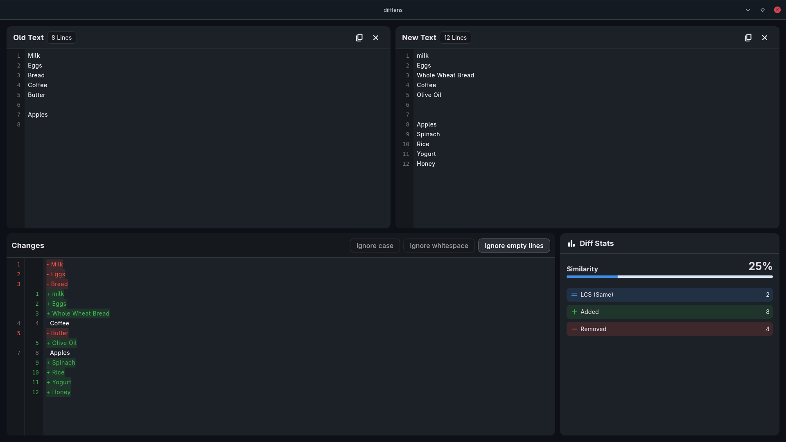
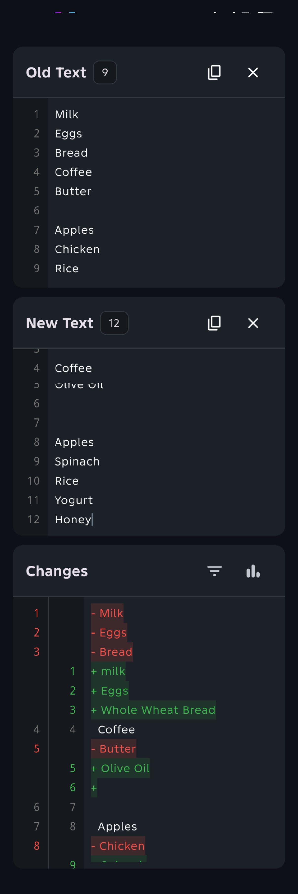
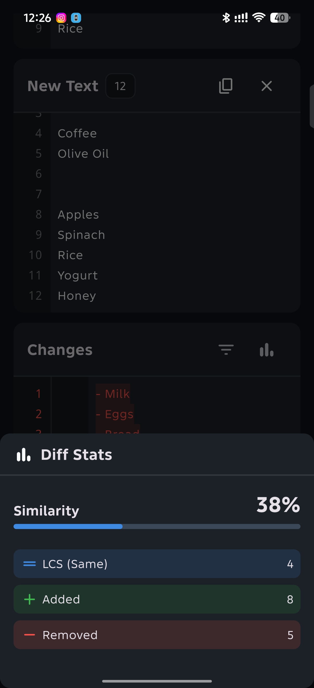
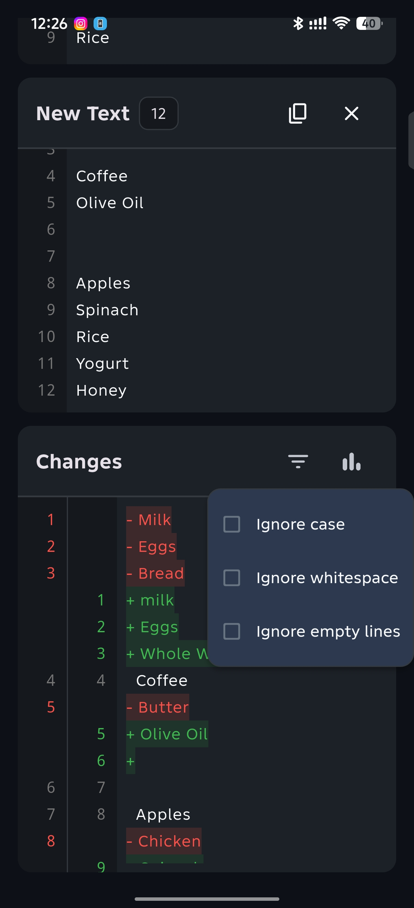
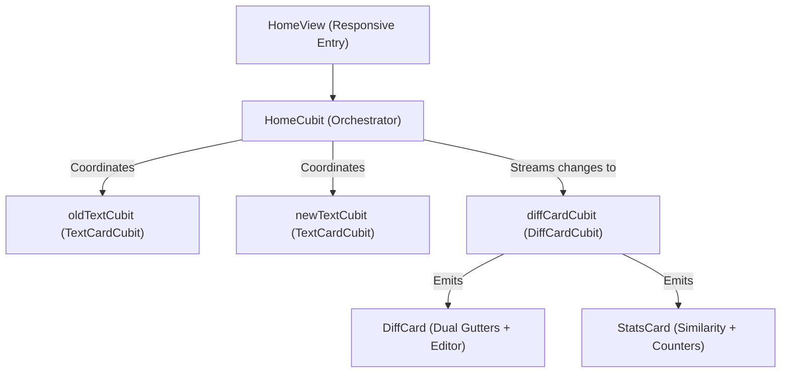

# 🔍 DiffLens

<p align="center">
  <strong>A sleek, high-performance, and responsive visual text diff tool built with Flutter & BLoC.</strong>
</p>

<p align="center">
  
  
  
  
</p>

---

## 📸 Screenshots

### 💻 Desktop Layout
<p align="center">
  
</p>

<p align="center">
  <em>Desktop Layout: Side-by-side inputs, Git-style diff card with dual line gutters, and real-time statistics panel.</em>
</p>

---

### 📱 Mobile Layout
<p align="center">
  
  &nbsp;
  
  &nbsp;
  
</p>

<p align="center">
  <em>Main Mobile View &nbsp; • &nbsp; Diff Statistics Bottom Sheet &nbsp; • &nbsp; Comparison Options Menu</em>
</p>

---

## ✨ Features

- **⚡ In-House LCS Diff Algorithm**: Pure Dart Longest Common Subsequence (LCS) engine with backtracking — zero heavy third-party diff dependencies.
- **🎨 Visual Line Highlighting**: Git-style green (`+`) addition and red (`-`) deletion styling with subtle background tints and colored gutter numbers.
- **🔢 Dual Line Number Gutters**: Independent old-line and new-line number columns that stay aligned and automatically blank out on insertions/deletions.
- **📜 Caret-Accurate Synchronized Scrolling**: Gutters query Flutter's `RenderEditable` directly to prevent line number drift during soft-wraps and fast scrolling.
- **🎛️ Real-Time Comparison Toggles**:
  - **Ignore Case**: Case-insensitive comparison.
  - **Ignore Whitespace**: Strips all whitespace characters to match content regardless of spacing (`git diff -w`).
  - **Ignore Empty Lines**: Filters out blank lines while preserving original line numbers (`git diff --ignore-blank-lines`).
- **📊 Real-Time Statistics Panel**:
  - **Similarity Percentage**: Calculated via Sørensen–Dice coefficient with visual color-coded progress indicator.
  - **Metrics Counter**: Track Added (`+X`), Removed (`-Y`), and Unchanged lines simultaneously.
- **📱 Fluid Responsive Animation**: Smooth `AnimatedSwitcher` (fade + micro-scale) that adapts between a multi-column desktop grid and mobile scrollable layout.
- **📋 Clipboard & Floating Toasts**: One-click copy with custom widget-anchored toastification popups.

---

## 🏗️ Architecture & State Management

DiffLens follows a clean, decoupled **BLoC/Cubit** architecture:



- **`HomeCubit`**: Central coordinator that synchronizes inputs and manages child cubit lifecycles.
- **`TextCardCubit`**: Handles individual text input, line counts, and clipboard actions.
- **`DiffCardCubit`**: Orchestrates diff calculation, comparison toggles, formatted text spans, and metric counters.

---

## 📁 Project Structure

```text
lib/
├── constants/            # App colors, editor metrics, and dimensions
├── controllers/          # Custom DiffTextEditingController with syntax coloring
├── cubits/               # State management (HomeCubit, DiffCardCubit, TextCardCubit)
├── models/               # Domain models (DiffLine, DiffType)
├── utils/                # Pure Dart LCS DiffEngine & toast helpers
├── views/                # Top-level views (HomeView)
└── widgets/              # Modular UI components (Cards, Gutters, Headers, Stats)
```
